# HỆ THỐNG ỨNG DỤNG HỌC TẬP TIỂU HỌC (LỚP 1 - LỚP 5)
## BỘ TÀI LIỆU THIẾT KẾ KIẾN TRÚC HỆ THỐNG (SYSTEM ARCHITECTURE DOCUMENT)
### Nền Tảng: Web & Mobile (Cross-Platform) | Hạ Tầng: Firebase Serverless (Tối Ưu 100% Gói Miễn Phí Spark Plan)

---

## 📌 1. Giới Thiệu Dự Án

Hệ thống ứng dụng học tập thông minh dành riêng cho học sinh tiểu học (từ 6 đến 11 tuổi, từ lớp 1 đến lớp 5), kết hợp giữa chương trình chuẩn của Bộ Giáo dục & Đào tạo (Toán, Tiếng Việt, Tiếng Anh, Tự nhiên & Xã hội) với phương pháp **Edutainment & Gamification** (học qua chơi, nuôi thú ảo, tích lũy huy hiệu, giải đố tương tác).

Dự án được thiết kế theo tiêu chí:
1. **Trải nghiệm đa nền tảng nhất quán (Web & Mobile)**: Học tập mượt mà trên điện thoại phụ huynh (iOS/Android), máy tính bảng và trình duyệt máy tính cá nhân.
2. **Thân thiện tối đa với trẻ nhỏ**: Giao diện trực quan, hỗ trợ âm thanh phát âm chuẩn, kéo thả sinh động, màu sắc tươi sáng, bảo vệ thị lực và tâm lý trẻ em.
3. **Chi phí vận hành hạ tầng 0 ĐỒNG (Zero-Cost Infrastructure)**: Kiến trúc tối ưu hóa tuyệt đối hạn ngạch gói **Firebase Spark Plan (Free Tier)** kết hợp mạng phân phối nội dung (CDN) và lưu trữ cục bộ (Offline-First Cache).

---

## 📑 2. Danh Mục Tài Liệu Thiết Kế Chi Tiết

Bộ tài liệu này được cấu trúc thành 7 chuyên đề kỹ thuật chuyên sâu tại thư mục `docs/`:

| STT | Tài Liệu | Nội Dung Trọng Tâm |
| :---: | --- | --- |
| **01** | [**Yêu Cầu Nghiệp Vụ & Phân Tích Chức Năng (SRS)**](docs/01_TONG_QUAN_VA_YEU_CAU_NGHIEP_VU.md) | Phân tích Persona (Lớp 1-2 vs Lớp 3-5 vs Phụ huynh vs Giáo viên), ma trận tính năng Toán - Tiếng Việt - Tiếng Anh, hệ thống bài tập tương tác, báo cáo phụ huynh. |
| **02** | [**Kiến Trúc Hệ Thống & Lựa Chọn Công Nghệ**](docs/02_KIEN_TRUC_HE_THONG_VA_CONG_NGHE.md) | C4 Model (Context, Container, Component), đánh giá so sánh Flutter vs React Native + React/Vite, đề xuất Stack tối ưu (Flutter đa nền tảng hoặc React Native + Next.js/Vite), xử lý Audio/Animation (Rive, Lottie). |
| **03** | [**Chiến Lược Tối Ưu Hóa Firebase Free Tier**](docs/03_CHIEN_LUOC_TOI_UU_FIREBASE_FREE_TIER.md) | Phân tích chi tiết định mức Spark Plan (50K reads/ngày, 20K writes/ngày, 1GB Storage, 10GB Hosting). Kỹ thuật Denormalization, Read Bundling, Local Caching (IndexedDB/Hive), Static Data offloading qua GitHub/jsDelivr CDN. |
| **04** | [**Thiết Kế Cơ Sở Dữ Liệu NoSQL (Firestore)**](docs/04_THIET_KE_CO_SO_DU_LIEU_FIRESTORE.md) | Sơ đồ ERD NoSQL, Schema chi tiết cho Users, Curriculums, Lessons, Exercises, UserProgress, Leaderboards. JSON mẫu, chiến lược Partitioning theo khối lớp, Composite Indexes. |
| **05** | [**An Ninh Bảo Mật, Quyền Trẻ Em & Security Rules**](docs/05_AN_NINH_BAO_MAT_VA_SECURITY_RULES.md) | Bộ mã nguồn `firestore.rules` và `storage.rules` hoàn chỉnh, an toàn tuyệt đối. Tuân thủ chuẩn bảo vệ trẻ em (COPPA, GDPR-K), Cổng kiểm soát phụ huynh (Parental Gate/PIN), Firebase App Check. |
| **06** | [**Thiết Kế UI/UX & Cơ Chế Gamification**](docs/06_THIET_KE_UI_UX_VA_GAMIFICATION.md) | Nguyên tắc thiết kế tâm lý học lứa tuổi (Khối 1-2 thiên về Icon/Voice/Minigame; Khối 3-5 thiên về Quiz logic/Bảng vàng). Hệ thống Pet ảo, XP, Streak, Badges và hiệu ứng âm thanh Sound Effects/TTS. |
| **07** | [**Lộ Trình Triển Khai & Giám Sát Chi Phí**](docs/07_LO_TRINH_TRIEN_KHAI_VA_GIAM_SAT.md) | Kế hoạch chia 4 giai đoạn (MVP -> Beta -> V1.0 -> Mở rộng), CI/CD tự động hóa, thiết lập Google Cloud Budget Alerts, cơ chế Circuit Breaker chặn cạn kiệt Quota. |

---

## 08. Apple Design Integration

Để áp dụng triết lý thiết kế Apple vào dự án, hãy tham khảo tài liệu hướng dẫn chi tiết:

- **[Apple Design Tokens (CSS)](docs/08_HUONG_DAN_THAY_DOI_THIET_KE_APPLE.md)** – Hệ thống token màu, font, bo góc, bóng, kích thước, và chuyển cảnh theo chuẩn Apple.
- **[Apple Human Interface Guidelines](https://developer.apple.com/design/human-interface-guidelines/)** – Tài liệu chính thức của Apple về thiết kế UI.
- **[SF Symbols](https://developer.apple.com/sf-symbols/)** – Hệ thống icon vector cho giao diện.

> **Lưu ý**: Tài liệu này kết hợp **30–40% triết lý Apple** (Clarity, Deference, Depth, Consistency, Direct Manipulation) với **60–70% Child-Centered Design** hiện tại để đảm bảo vừa chuyên nghiệp vừa thân thiện với trẻ em.

| STT | Tài Liệu | Nội Dung Trọng Tâm |
| :---: | :--- | :--- |
| **01** | [**Yêu Cầu Nghiệp Vụ & Phân Tích Chức Năng (SRS)**](docs/01_TONG_QUAN_VA_YEU_CAU_NGHIEP_VU.md) | Phân tích Persona (Lớp 1-2 vs Lớp 3-5 vs Phụ huynh vs Giáo viên), ma trận tính năng Toán - Tiếng Việt - Tiếng Anh, hệ thống bài tập tương tác, báo cáo phụ huynh. |
| **02** | [**Kiến Trúc Hệ Thống & Lựa Chọn Công Nghệ**](docs/02_KIEN_TRUC_HE_THONG_VA_CONG_NGHE.md) | C4 Model (Context, Container, Component), đánh giá so sánh Flutter vs React Native + React/Vite, đề xuất Stack tối ưu (Flutter đa nền tảng hoặc React Native + Next.js/Vite), xử lý Audio/Animation (Rive, Lottie). |
| **03** | [**Chiến Lược Tối Ưu Hóa Firebase Free Tier**](docs/03_CHIEN_LUOC_TOI_UU_FIREBASE_FREE_TIER.md) | Phân tích chi tiết định mức Spark Plan (50K reads/ngày, 20K writes/ngày, 1GB Storage, 10GB Hosting). Kỹ thuật Denormalization, Read Bundling, Local Caching (IndexedDB/Hive), Static Data offloading qua GitHub/jsDelivr CDN. |
| **04** | [**Thiết Kế Cơ Sở Dữ Liệu NoSQL (Firestore)**](docs/04_THIET_KE_CO_SO_DU_LIEU_FIRESTORE.md) | Sơ đồ ERD NoSQL, Schema chi tiết cho Users, Curriculums, Lessons, Exercises, UserProgress, Leaderboards. JSON mẫu, chiến lược Partitioning theo khối lớp, Composite Indexes. |
| **05** | [**An Ninh Bảo Mật, Quyền Trẻ Em & Security Rules**](docs/05_AN_NINH_BAO_MAT_VA_SECURITY_RULES.md) | Bộ mã nguồn `firestore.rules` và `storage.rules` hoàn chỉnh, an toàn tuyệt đối. Tuân thủ chuẩn bảo vệ trẻ em (COPPA, GDPR-K), Cổng kiểm soát phụ huynh (Parental Gate/PIN), Firebase App Check. |
| **06** | [**Thiết Kế UI/UX & Cơ Chế Gamification**](docs/06_THIET_KE_UI_UX_VA_GAMIFICATION.md) | Nguyên tắc thiết kế tâm lý học lứa tuổi (Khối 1-2 thiên về Icon/Voice/Minigame; Khối 3-5 thiên về Quiz logic/Bảng vàng). Hệ thống Pet ảo, XP, Streak, Badges và hiệu ứng âm thanh Sound Effects/TTS. |
| **07** | [**Lộ Trình Triển Khai & Giám Sát Chi Phí**](docs/07_LO_TRINH_TRIEN_KHAI_VA_GIAM_SAT.md) | Kế hoạch chia 4 giai đoạn (MVP -> Beta -> V1.0 -> Mở rộng), CI/CD tự động hóa, thiết lập Google Cloud Budget Alerts, cơ chế Circuit Breaker chặn cạn kiệt Quota. |

---

## 🏛️ 3. Sơ Đồ Kiến Trúc Tổng Thể (High-Level Overview)

```mermaid
flowchart TB
    subgraph CLIENTS["LỚP CLIENT (ĐA NỀN TẢNG)"]
        MobileApp["📱 Mobile App (Flutter / React Native)<br/>- iOS & Android<br/>- Hive / SQLite Offline Cache<br/>- Audio & Rive Animation Engine"]
        WebApp["💻 Web App (Flutter Web / React SPA)<br/>- Chrome / Edge / Safari Desktop & Tablet<br/>- IndexedDB Local Persistence<br/>- Service Worker PWA"]
    end

    subgraph CDN_LAYER["LỚP CDN & PHÂN PHỐI NỘI DUNG TĨNH (FREE)"]
        FB_Hosting["🌐 Firebase Hosting (Free 10GB/mo bandwidth)<br/>- Phục vụ Web Bundle (HTML, JS, CSS)<br/>- SSL tự động"]
        StaticCDN["⚡ Static Assets CDN (GitHub Pages / Cloudflare R2 / jsDelivr)<br/>- Âm thanh phát âm (MP3), Hình ảnh minh họa bài học<br/>- Animation JSON (Lottie/Rive)<br/>*Tiết kiệm 100% Egress của Firebase Storage*"]
    end

    subgraph FIREBASE_SERVICES["HẠ TẦNG FIREBASE SERVERLESS (SPARK PLAN - 0 ĐỒNG)"]
        FB_Auth["🔑 Firebase Authentication<br/>- Email/Password (Phụ huynh)<br/>- Anonymous Auth (Học sinh trải nghiệm ngay)<br/>- 50,000 MAU Miễn phí"]
        FB_Firestore["🗄️ Cloud Firestore (NoSQL Database)<br/>- Quota: 50K Reads, 20K Writes, 1GB Storage/ngày<br/>- Cache-First Query Strategy<br/>- Aggregated Progress Documents"]
        FB_Storage["📦 Firebase Cloud Storage<br/>- Lưu avatar, bài vẽ của bé (User-generated content)<br/>- Quota: 5GB dung lượng, 1GB egress/ngày"]
        FB_FCM["🔔 Firebase Cloud Messaging (FCM)<br/>- Nhắc nhở học tập hàng ngày cho phụ huynh<br/>- Miễn phí 100% không giới hạn"]
        FB_RemoteConfig["⚙️ Firebase Remote Config<br/>- Feature Flags, Cấu hình mùa lễ hội, Game banner<br/>- Miễn phí 100%"]
        FB_AppCheck["🛡️ Firebase App Check<br/>- Chống bot, bảo vệ API key & ngăn lạm dụng Quota"]
    end

    MobileApp -->|Tải trang & PWA| FB_Hosting
    WebApp -->|Tải trang & Assets Web| FB_Hosting
    MobileApp & WebApp -->|Tải Media nặng: Audio MP3, Hình học, Tranh vẽ| StaticCDN
    
    MobileApp & WebApp -->|Xác thực người dùng| FB_Auth
    MobileApp & WebApp -->|Đọc/Ghi dữ liệu học tập có Cache| FB_Firestore
    MobileApp & WebApp -->|Tải bài tập vẽ / hình đại diện| FB_Storage
    MobileApp & WebApp -->|Nhận thông báo nhắc học| FB_FCM
    MobileApp & WebApp -->|Cập nhật cấu hình động| FB_RemoteConfig
    MobileApp & WebApp -.->|Chứng thực Client hợp lệ| FB_AppCheck
```

---

## 🎯 4. Tóm Tắt Chiến Lược "Bí Quyết" Giữ Chi Phí Firebase Bằng 0

Để một ứng dụng học tập phục vụ hàng nghìn học sinh hoạt động hoàn hảo trên **Spark Plan (0 USD/tháng)** mà không bao giờ bị khóa tài khoản vì quá tải quota:

1. **Tách Biệt Tuyệt Đối Dữ Liệu Tĩnh (Static Data) và Dữ Liệu Động (Dynamic Data)**:
   - Giáo trình, bài học, câu hỏi trắc nghiệm, file âm thanh, ảnh hoạt hình là dữ liệu tĩnh. Dữ liệu này **KHÔNG** được gọi trực tiếp mỗi lần từ Firestore hay Storage của Firebase. Thay vào đó, chúng được đóng gói một phần vào App Asset nội bộ, hoặc lưu trữ trên CDN miễn phí (GitHub Releases / Cloudflare CDN / jsDelivr) với dung lượng truyền tải không giới hạn.
2. **Kỹ Thuật Gom Đọc (Read Aggregation / Denormalization)**:
   - Thay vì thiết kế quan hệ truyền thống (mỗi câu hỏi là 1 document -> làm bài thi 30 câu tốn 30 lượt Read), toàn bộ 1 bài học 30 câu hỏi được gom thành **1 Document JSON duy nhất** -> Chỉ tốn **1 lượt Read**.
3. **Tiến Trình Học Tập Ghi Gom (Batching & Local Buffer Writes)**:
   - Học sinh làm từng câu hỏi không ghi ngay lên Firestore. Kết quả được lưu tại bộ nhớ máy (Local State/SQLite/IndexedDB). Khi hoàn thành cả bài hoặc kết thúc phiên học mới gửi một bản tóm tắt điểm số và sao thưởng bằng **1 lần Write duy nhất**.
4. **Bật Tối Đa Bộ Nhớ Đệm Firestore (Persistent Offline Cache)**:
   - Client tận dụng Cache nội bộ của Firestore SDK. Khi học sinh học lại bài cũ hoặc xem lại lý thuyết, SDK tự động lấy từ Local Storage/IndexedDB mà **tốn 0 lượt Read** từ máy chủ.

---

*Tài liệu được soạn thảo và kiểm định theo tiêu chuẩn kiến trúc phần mềm hiện đại, tuân thủ nghiêm ngặt các quy định về an toàn thông tin và bảo vệ quyền riêng tư của trẻ em trên không gian mạng.*
