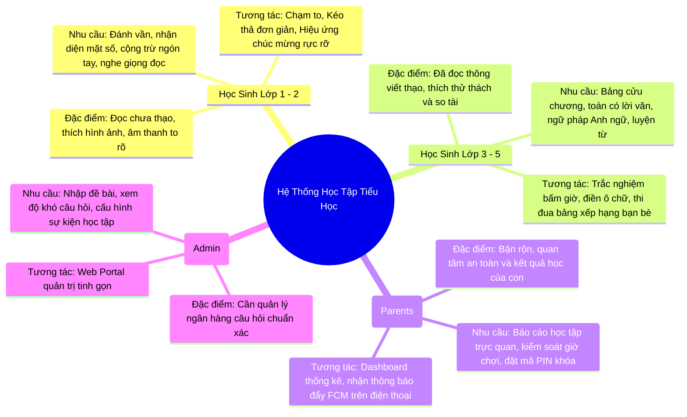
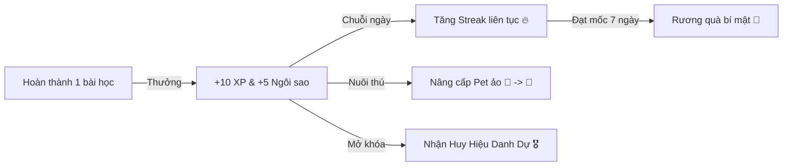

# CHUYÊN ĐỀ 01: TỔNG QUAN HỆ THỐNG VÀ PHÂN TÍCH YÊU CẦU NGHIỆP VỤ (SRS)
## Ứng Dụng Học Tập Tiểu Học (Lớp 1 đến Lớp 5) - Nền Tảng Web & Mobile

---

## 1. Bối Cảnh & Mục Tiêu Dự Án

### 1.1. Bối cảnh thị trường & Nhu cầu thực tế
Học sinh tiểu học (từ 6 đến 11 tuổi) là giai đoạn vàng hình thành tư duy logic, thói quen tự học và tình yêu khám phá tri thức. Tuy nhiên, các ứng dụng học tập hiện nay thường gặp các rào cản:
- Quá nhiều quảng cáo gây xao nhãng hoặc rủi ro an toàn mạng cho trẻ nhỏ.
- Giao diện người lớn, chữ quá nhỏ, thiếu tương tác âm thanh trực quan phù hợp với các bé lớp 1, lớp 2 chưa thạo đọc chữ.
- Chi phí bản quyền cao, hoặc hệ thống máy chủ đắt đỏ dẫn đến mô hình thu phí nặng nề.
- Thiếu sự liên thông giữa Web (dùng trên máy tính bàn, laptop ở nhà/trường học) và Mobile (dùng trên điện thoại/tablet của bố mẹ khi di chuyển).

### 1.2. Mục tiêu chiến lược của hệ thống
1. **Bao phủ chuẩn chương trình giáo dục tiểu học Việt Nam**: Xây dựng kho học liệu môn Toán, Tiếng Việt, Tiếng Anh từ Lớp 1 đến Lớp 5 theo chuẩn mới (Chân trời sáng tạo, Kết nối tri thức, Cánh diều).
2. **Trải nghiệm Học - Mà - Chơi (Gamification)**: Biến các bài học khô khan thành các chặng phiêu lưu, thu thập huy hiệu, nuôi dưỡng linh vật ảo (Pet), kích thích tính tự giác của học sinh.
3. **Bảo vệ toàn diện trẻ em**: Không quảng cáo độc hại, có "Cổng phụ huynh" (Parental Gate) và mã PIN để phụ huynh thiết lập giới hạn giờ học (Screen-time control).
4. **Hạ tầng 0 ĐỒNG (Zero Infrastructure Cost)**: Tối ưu 100% tài nguyên miễn phí của Firebase (Spark Plan) để duy trì hệ thống hoạt động ổn định cho cộng đồng mà không phát sinh chi phí duy trì máy chủ hàng tháng.

---

## 2. Phân Tích Chân Dung Người Dùng (User Personas)

### 2.1. Nhóm Học Sinh Lớp 1 & Lớp 2 (Độ tuổi 6 - 7)
- **Hành vi & Tâm lý**:
  - Khả năng đọc chữ còn chậm; chủ yếu nhận diện qua biểu tượng (Icon), màu sắc và âm thanh.
  - Khả năng tập trung ngắn (khoảng 10 - 15 phút mỗi phiên học).
  - Cần sự động viên tức thì (âm thanh "Chính xác rồi!", pháo hoa, vỗ tay, tặng ngôi sao).
- **Yêu cầu UI/UX đặc thù**:
  - Nút bấm cực to (tối thiểu 48x48dp), khoảng cách rộng tránh bấm nhầm.
  - Mọi câu hỏi, đề bài và từ vựng đều phải có nút bấm loa phát âm giọng đọc chuẩn (Text-to-Speech hoặc Audio thu âm chất lượng cao).
  - Tương tác chính: Chọn 1 trong 2/3 hình, kéo thả hình ảnh tương ứng, nối cặp hình ảnh.

### 2.2. Nhóm Học Sinh Lớp 3, 4 & Lớp 5 (Độ tuổi 8 - 11)
- **Hành vi & Tâm lý**:
  - Khả năng đọc hiểu độc lập, đã có ý thức thi đua và thích thể hiện năng lực.
  - Hứng thú với cơ chế thăng cấp (Leveling), thu thập trang phục cho linh vật, chuỗi ngày học liên tục (Streak).
  - Thích các dạng bài tập thách đố, toán tư duy logic, thi đấu tính giờ.
- **Yêu cầu UI/UX đặc thù**:
  - Giao diện hiện đại hơn, bảng câu hỏi dạng Quiz, điền số, sắp xếp trật tự từ, đọc đoạn văn và trả lời câu hỏi.
  - Hiển thị thanh tiến trình bài học, đồng hồ đếm ngược (nếu ở chế độ luyện thi), bảng xếp hạng tuần theo lớp.

### 2.3. Nhóm Phụ Huynh (Parents)
- **Nhu cầu**:
  - Nắm bắt điểm mạnh, điểm yếu của con (Ví dụ: "Bé làm sai nhiều ở phần Phép chia có dư").
  - Đặt giới hạn thời gian sử dụng màn hình (Ví dụ: Tự động khóa sau 30 phút học mỗi ngày).
  - An tâm tuyệt đối: Không có tính năng mạng xã hội mở cho người lạ nhắn tin với trẻ; dữ liệu vị trí không bị thu thập.

---

## 3. Ma Trận Phân Hệ Chức Năng Chi Tiết (Functional Requirements)

### 3.1. Phân Hệ Học Tập Môn Toán (Mathematics)
| Khối Lớp | Chủ Đề Trọng Tâm | Dạng Bài Tập Tương Tác | Cơ Chế Hỗ Trợ Trẻ Em |
| :--- | :--- | :--- | :--- |
| **Lớp 1** | Đếm số 1-100, So sánh lớn/bé/bằng, Cộng trừ trong phạm vi 10, 20, 100 không nhớ. | Kéo thả quả táo vào giỏ, chọn que tính, nối số với số lượng chấm tròn. | Âm thanh đếm số từng nhịp, que tính động minh họa trực quan. |
| **Lớp 2** | Bảng nhân 2 & 5, Bảng chia, Phép cộng trừ có nhớ trong phạm vi 1000, Hình học cơ bản (tam giác, tứ giác). | Chọn đáp án đúng, ráp mảnh ghép hình học, giải đố tìm đường mê cung số. | Bàn tính ảo (Abacus) thao tác trực tiếp trên màn hình. |
| **Lớp 3** | Bảng cửu chương toàn phần (1-9), Số có 4-5 chữ số, Đo lường (gam, kg, ml, lít), Chu vi & Diện tích chữ nhật/vuông. | Điền số vào chỗ trống, kéo thước đo chiều dài đồ vật, tính nhẩm nhanh 60 giây. | Gợi ý từng bước khi làm sai lần thứ nhất. |
| **Lớp 4** | Phân số, Bốn phép tính phân số, Dấu hiệu chia hết (2, 3, 5, 9), Trung bình cộng, Biểu đồ cột. | Tô màu phân số trên hình tròn/thanh sô-cô-la, kéo thả rút gọn phân số. | Minh họa tương tác phân số bằng hình ảnh trực quan. |
| **Lớp 5** | Số thập phân, Phần trăm (%), Vận tốc - Quãng đường - Thời gian, Thể tích hình hộp/lập phương. | Trắc nghiệm bấm giờ, giải toán có lời văn từng bước logic, đồ thị di chuyển xe cộ. | Bảng nháp điện tử (Scratchpad) ngay trên ứng dụng để học sinh tính nhẩm. |

### 3.2. Phân Hệ Học Tập Môn Tiếng Việt (Vietnamese Language)
| Khối Lớp | Chủ Đề Trọng Tâm | Dạng Bài Tập Tương Tác |
| :--- | :--- | :--- |
| **Lớp 1** | 29 chữ cái, Bảng vần, 5 dấu thanh (Huyền, Sắc, Hỏi, Ngã, Nặng), Ghép âm đơn & âm ghép (ch, gh, kh, ph, th, tr...). | Nghe âm thanh bấm chọn chữ cái, chạm vào bong bóng chứa vần đúng, ghép chữ cái thành từ có nghĩa. |
| **Lớp 2** | Tập đọc trôi chảy, Quy tắc chính tả (c/k, g/gh, ng/ngh), Mở rộng vốn từ chỉ người/đồ vật/con vật, Dấu chấm, dấu phẩy. | Nghe audio từ mẫu rồi chọn từ viết đúng chính tả, nối từ chỉ đặc điểm với hình ảnh minh họa tương ứng. |
| **Lớp 3** | Biện pháp tu từ: So sánh, Nhân hóa; Luyện từ và câu: Từ đồng nghĩa, từ trái nghĩa; Cấu tạo câu đơn. | Gạch chân từ ngữ so sánh trong câu thơ, kéo thả điền từ trái nghĩa vào ô trống, xếp trật tự từ tạo câu hoàn chỉnh. |
| **Lớp 4 & 5**| Từ loại (Danh từ, Động từ, Tính từ, Đại từ), Câu ghép, Ôn luyện thành ngữ & tục ngữ Việt Nam, Đọc hiểu văn bản. | Phân loại từ vào đúng hộp (Hộp Danh từ - Động từ - Tính từ), đố vui ô chữ tìm thành ngữ, trắc nghiệm đọc hiểu văn bản ngắn. |

### 3.3. Phân Hệ Học Tập Môn Tiếng Anh (Primary English)
- **Flashcard tương tác đa giác quan**: Mỗi từ vựng gồm: Hình ảnh minh họa hoạt hình sắc nét + Chữ viết + Phiên âm quốc tế IPA + Audio phát âm bản xứ chuẩn + Bản dịch tiếng Việt kèm ví dụ thực tế.
- **Luyện phát âm & Nghe phản xạ**:
  - Bài tập *Listen and Choose*: Nghe một đoạn hội thoại ngắn hoặc từ đơn rồi chạm vào tranh vẽ chính xác.
  - Trò chơi *Spelling Bee*: Nghe từ và sắp xếp lại các chữ cái xáo trộn thành từ hoàn chỉnh.
- **Hệ thống theo chủ đề gần gũi**: Gia đình (Family), Động vật (Animals), Màu sắc (Colors), Trường học (School), Thức ăn (Food), Thể thao & Sở thích (Hobbies).

### 3.4. Phân Hệ Gamification (Học Qua Chơi)

1. **Linh vật đồng hành (Study Mascot/Pet)**:
   - Bé được chọn một trứng linh vật khi bắt đầu (Cú thông thái, Rồng lửa dũng cảm, Mèo con lanh lợi).
   - Khi hoàn thành bài học, bé nhận được Thức ăn / Năng lượng để nuôi linh vật lớn lên qua từng cấp độ.
2. **Hệ thống phần thưởng (Economy Loop)**:
   - **XP (Kinh nghiệm)**: Đo lường độ chăm chỉ, dùng để thăng cấp học viên (Tân binh -> Thám hiểm -> Học giả nhí -> Trạng nguyên).
   - **Sao (Stars / Coins)**: Dùng để đổi trang phục, hình nền hoặc mở khóa các mini-game giải trí trí tuệ (Sudoku nhí, Xếp hình logic).
   - **Streak (Ngọn lửa chăm chỉ)**: Ghi nhận số ngày học tập liên tiếp. Có cơ chế "Khiên bảo vệ Streak" (Streak Freeze) giúp trẻ không bị nản lòng nếu lỡ nghỉ 1 ngày có việc gia đình.
3. **Bảng Vinh Danh Tuần (Weekly Leaderboard)**:
   - Chia theo nhóm nhỏ (League 30 bạn cùng khối lớp) để các bé thi đua mà không gây áp lực quá tải toàn quốc.

### 3.5. Phân Hệ Phụ Huynh (Parental Control & Dashboard)
1. **Parental Gate (Cổng bảo vệ phụ huynh)**:
   - Trước khi vào trang cài đặt hoặc liên kết thanh toán/thoát app, hệ thống yêu cầu giải một bài toán nhân nâng cao hoặc nhập mã PIN 4 số mà chỉ người lớn mới biết.
2. **Báo cáo tiến trình thông minh**:
   - Biểu đồ thời lượng học trong tuần (Tổng số phút học/ngày).
   - Tỷ lệ đúng/sai theo từng chuyên đề kỹ năng (Toán số học, Hình học, Chính tả, Từ vựng).
   - Danh sách "Những câu con hay làm nhầm" kèm nút bấm "Cùng con ôn lại ngay".
3. **Cài đặt giới hạn thời gian (Screen Time Timer)**:
   - Tùy chỉnh hẹn giờ học (Ví dụ: 20 phút, 30 phút, 45 phút). Khi hết giờ, ứng dụng hiển thị thông báo dễ thương "Đã đến giờ cho mắt nghỉ ngơi rồi bé ơi!" và tạm khóa màn hình bài học.

---

## 4. Yêu Cầu Phi Chức Năng (Non-Functional Requirements - NFR)

| Tiêu Chí | Yêu Cầu Kỹ Thuật | Giải Pháp Đáp Ứng |
| :--- | :--- | :--- |
| **Hiệu năng & Tốc độ** | Tải trang/màn hình < 1.5 giây trên 4G/Wifi thông thường. Phản hồi âm thanh/chạm < 100ms. | Tải trước (Preload) bộ audio và animation ngắn vào bộ nhớ RAM của thiết bị. |
| **Khả năng Offline** | Hoạt động bình thường khi mất kết nối mạng internet đối với bài học đã mở. | Lưu trữ cục bộ toàn bộ tiến trình vào SQLite/Hive trên Mobile và IndexedDB trên Web. |
| **Dung lượng cài đặt** | App Mobile tải về < 40MB. Web App tải lần đầu < 2.5MB (Gzip). | Không nhúng toàn bộ tệp âm thanh/video vào file cài đặt; tải theo luồng và lưu cache theo nhu cầu. |
| **Độ tương thích thiết bị** | Chạy tốt trên màn hình từ 4.7 inch (Điện thoại cũ) đến 12.9 inch (iPad Pro) và Màn hình máy tính 1920x1080. | Giao diện thích ứng (Responsive & Adaptive Layout), khóa tỷ lệ khung hình chuẩn cho bài tập tương tác. |
| **An toàn & Bảo mật trẻ em** | Tuân thủ luật COPPA (Mỹ) và Nghị định 56/2017/NĐ-CP (Việt Nam) về bảo vệ trẻ em trên môi trường mạng. | Tuyệt đối không thu thập họ tên đầy đủ, trường học chính xác, vị trí GPS hay số điện thoại của trẻ em. |
| **Giới hạn chi phí (Cost Limit)** | **0 ĐỒNG** chi phí vận hành máy chủ hàng tháng trong giai đoạn phục vụ dưới 10,000 học sinh. | Tối ưu hóa triệt để Firebase Spark Plan kết hợp Static CDN miễn phí. |
