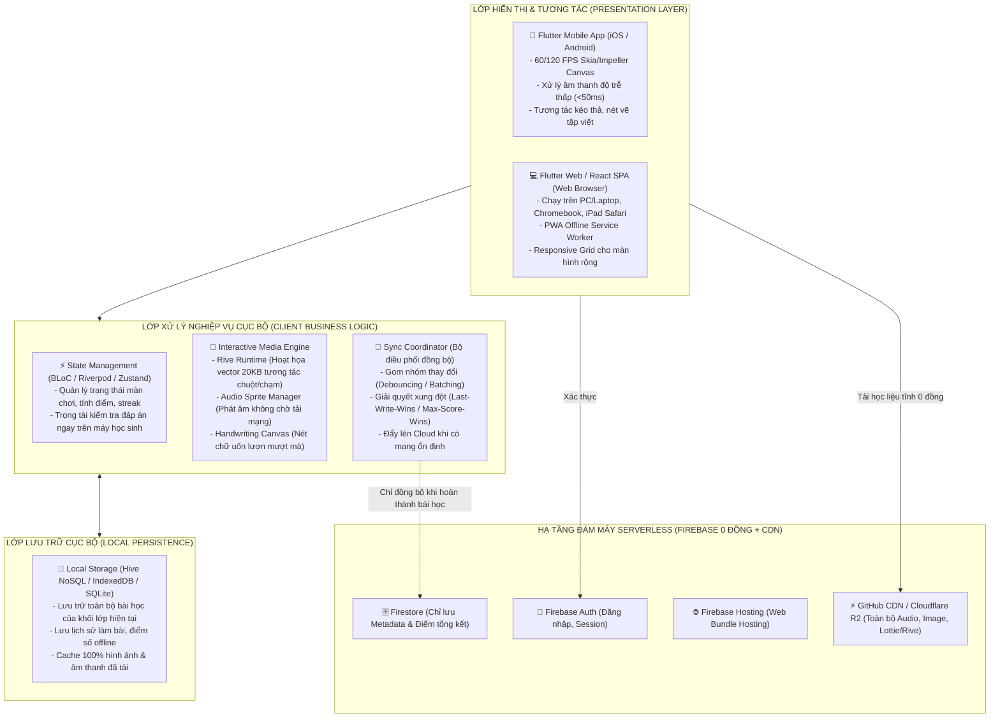
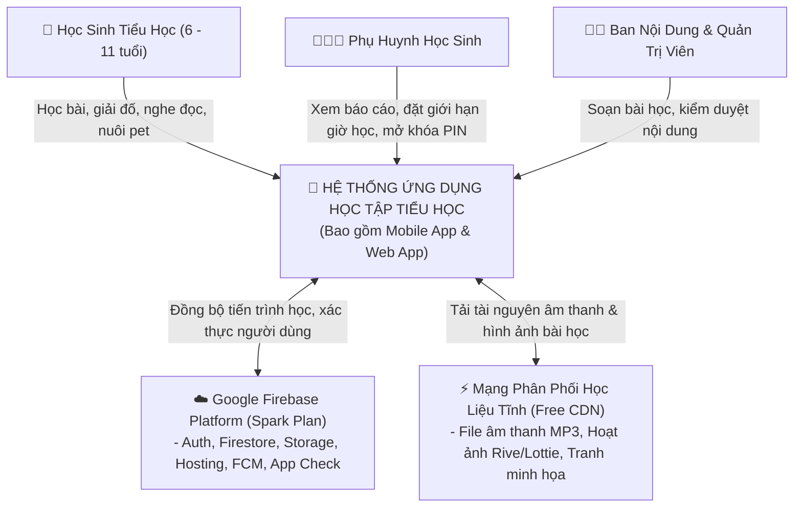
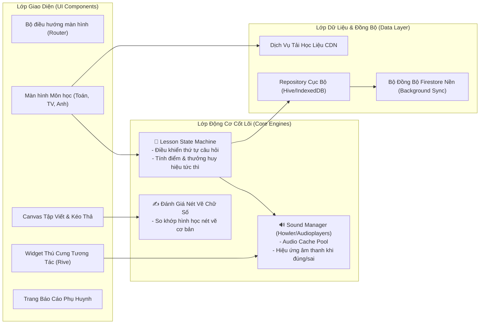
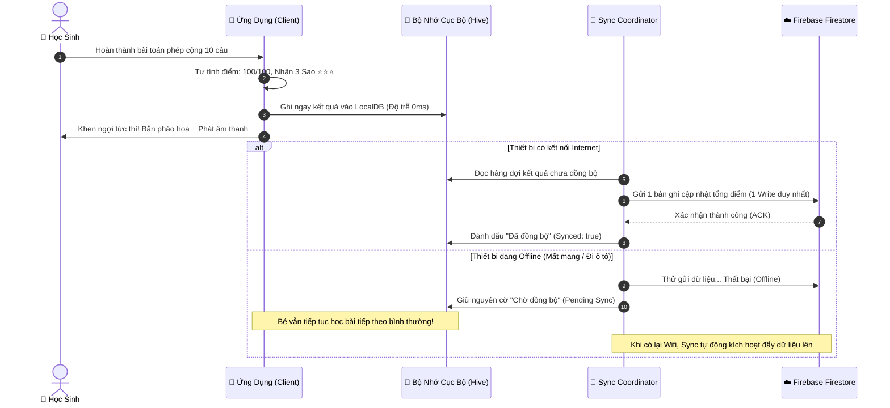

# CHUYÊN ĐỀ 02: THIẾT KẾ KIẾN TRÚC HỆ THỐNG VÀ LỰA CHỌN CÔNG NGHỆ
## Kiến Trúc Serverless Đa Nền Tảng (Cross-Platform) & Tối Ưu Tương Tác Học Tập

---

## 1. Phong Cách Kiến Trúc Tổng Thể (Architectural Style)

Hệ thống được xây dựng theo mô hình **Serverless Jamstack + Client-Centric Cross-Platform Architecture**, kết hợp triết lý **Offline-First (Ưu tiên ngoại tuyến)**.



### Điểm cốt lõi của kiến trúc:
1. **Logic chấm điểm chuyển dời về Client (Client-Side Evaluation)**:
   - Học sinh làm bài tập trắc nghiệm, ghép chữ, tính nhẩm không cần gửi HTTP Request lên server để hỏi "Đúng hay sai?".
   - Cấu trúc bài học tải về đã chứa sẵn metadata đáp án (được mã hóa cơ bản hoặc che giấu cục bộ). Client tính điểm ngay lập tức, phát âm thanh chúc mừng trong tích tắc (dưới 50ms), loại bỏ hoàn toàn độ trễ mạng và không tốn 1 lượt gọi Cloud Function nào.
2. **Offline-First làm trọng tâm**:
   - Ứng dụng luôn đọc và ghi vào Local Storage trước. Khi có Internet, Sync Coordinator sẽ âm thầm đồng bộ dữ liệu điểm số và tiến trình lên Firestore theo lô (Batch Write).

---

## 2. Mô Hình Kiến Trúc C4 (C4 Architecture Model)

### 2.1. C4 - Level 1: Sơ Đồ Ngữ Cảnh Hệ Thống (System Context Diagram)



### 2.2. C4 - Level 2: Sơ Đồ Vùng Chứa (Container Diagram)

```mermaid
flowchart TB
    subgraph ClientContainers["VÙNG CHỨA PHÍA THIẾT BỊ NGƯỜI DÙNG"]
        MobileContainer["📱 Ứng Dụng Di Động (iOS & Android)<br/>Công nghệ: Flutter / React Native<br/>Trách nhiệm: Trải nghiệm cảm ứng mượt mà, bài tập kéo thả, rung haptic, âm thanh trực tiếp"]
        WebContainer["💻 Ứng Dụng Web (Desktop & Tablet Browser)<br/>Công nghệ: Flutter Web / React PWA<br/>Trách nhiệm: Dạy học trên máy tính ở trường/ở nhà, bàn phím số, chuột"]
    end

    subgraph FirebaseContainers["VÙNG CHỨA FIREBASE SERVICES (SPARK PLAN)"]
        AuthContainer["🔑 Firebase Authentication<br/>Xử lý Anonymous Auth & Email/Password"]
        FirestoreContainer["🗄️ Cloud Firestore<br/>Lưu trữ dữ liệu hồ sơ, điểm bài học, bảng xếp hạng tuần"]
        StorageContainer["📦 Firebase Storage<br/>Lưu trữ avatar cá nhân hóa và bài vẽ của học sinh"]
        HostingContainer["🌐 Firebase Hosting<br/>Phục vụ Web App Production Build với CDN toàn cầu"]
        FCMContainer["🔔 Firebase Cloud Messaging<br/>Gửi thông báo đẩy nhắc lịch học hàng ngày cho cha mẹ"]
    end

    subgraph ExternalContainers["VÙNG CHỨA TÀI NGUYÊN TĨNH MIỄN PHÍ"]
        CDNContainer["⚡ Static CDN (GitHub Raw / Cloudflare Workers/R2 / jsDelivr)<br/>Lưu trữ ~500MB dữ liệu âm thanh phát âm, chữ cái, hình ảnh hoạt hình"]
    end

    MobileContainer & WebContainer -->|Xác thực ID Token| AuthContainer
    MobileContainer & WebContainer -->|Gửi/Nhận tiến trình có cache| FirestoreContainer
    MobileContainer & WebContainer -->|Upload tranh vẽ của bé| StorageContainer
    WebContainer -->|Tải trang lần đầu| HostingContainer
    MobileContainer <-- Nhận Push Notification| FCMContainer
    MobileContainer & WebContainer -->|Tải file âm thanh/video hoạt họa| CDNContainer
```

### 2.3. C4 - Level 3: Sơ Đồ Thành Phần Bên Trong Client (Component Diagram)



---

## 3. So Sánh Chi Tiết & Đề Xuất Công Nghệ Tối Ưu

Để phát triển ứng dụng bao gồm cả **Web** và **Mobile**, có hai phương án công nghệ hàng đầu trên thị trường hiện nay:

### Phương Án A: **FLUTTER (Dart)** cho cả Mobile (iOS, Android) và Web
### Phương Án B: **REACT NATIVE (Expo)** cho Mobile + **REACT (Vite/Next.js)** cho Web

---

### 3.1. Bảng So Sánh Kỹ Thuật Toàn Diện

| Tiêu Chí Đánh Giá | PHƯƠNG ÁN A: FLUTTER (Một Codebase Duy Nhất) | PHƯƠNG ÁN B: REACT NATIVE + REACT WEB (Hai Codebase / Monorepo) | Đánh Giá Tác Động Cho Ứng Dụng Tiểu Học |
| :--- | :--- | :--- | :--- |
| **Độ nhất quán đồ họa & Hoạt ảnh** | ⭐⭐⭐⭐⭐ **Tuyệt đối**: Flutter tự vẽ toàn bộ giao diện bằng engine Skia/Impeller, đảm bảo trên mọi máy học sinh (Samsung cũ, iPad, máy tính bàn) hiển thị chính xác từng pixel và hoạt ảnh 60-120fps. | ⭐⭐⭐⭐☆ Tốt trên Mobile, nhưng trên Web dùng HTML DOM nên giao diện vẽ tự do/kéo thả phức tạp cần tinh chỉnh CSS riêng để không bị lệch tỷ lệ. | **Flutter thắng thế**: Ứng dụng lớp 1-5 có rất nhiều hình ảnh hoạt họa, thước đo, bàn tính ảo, ghép hình. |
| **Tốc độ xử lý Âm thanh (Audio Latency)** | ⭐⭐⭐⭐⭐ Cực nhanh (<30ms) với plugin `audioplayers` hoặc `soloud` gốc C++. Không bị khựng tiếng khi bé bấm liên tục nhiều âm tiết. | ⭐⭐⭐⭐☆ Tốt trên Mobile (Expo AV), trên Web phụ thuộc HTML5 Audio API. | **Flutter tối ưu hơn** cho bài tập đánh vần Tiếng Việt ghép âm nhanh. |
| **Dung lượng tải trang Web (First Load)** | ⭐⭐⭐☆☆ Nặng hơn (Khoảng 2MB - 3.5MB cho Web Canvas/WASM). Cần thêm Splash Screen sinh động khi mở Web. | ⭐⭐⭐⭐⭐ Cực nhẹ (React SPA bundle chỉ ~300KB - 800KB), tối ưu SEO tốt hơn. | **React Web chiếm ưu thế** về tốc độ mở trang lần đầu trên trình duyệt yếu. |
| **Hỗ trợ Hoạt họa tương tác cao cấp (Rive Engine)** | ⭐⭐⭐⭐⭐ Rive hỗ trợ runtime Flutter hoàn hảo nhất hiện nay, cho phép đổi biểu cảm Pet (vui, buồn, nhảy múa) theo biến số thời gian thực. | ⭐⭐⭐⭐☆ Có hỗ trợ Rive runtime cho React và React Native. | Cả hai đều rất tốt. |
| **Chi phí bảo trì & Nguồn lực phát triển** | ⭐⭐⭐⭐⭐ **1 Ngôn ngữ (Dart), 1 Codebase, 1 Đội ngũ**: Viết 1 bài tập toán kéo thả, chạy được ngay trên cả Web, Android và iOS. | ⭐⭐⭐☆☆ Cần duy trì 2 giao diện riêng: React Native (JSX Native) và React Web (HTML/CSS), hoặc phải dùng React Native for Web khá phức tạp. | **Flutter giúp tiết kiệm 50% thời gian** lập trình và bảo trì lỗi logic. |

---

### 3.2. Đề Xuất Kiến Trúc Công Nghệ Chuẩn Xác Nhất

Dựa trên đặc thù của ứng dụng giáo dục tiểu học (đòi hỏi **tương tác hoạt hình phong phú, âm thanh trực quan, tính toán đồ họa kéo thả sinh động** và **chi phí vận hành 0 đồng**):

#### 🏆 KHUYẾN NGHỊ CHÍNH (RECOMMENDED): **FLUTTER MULTI-PLATFORM (Dart)**
- **Mobile (iOS & Android)**: Flutter Native (Impeller Engine) -> Đạt hiệu năng đồ họa tối đa.
- **Web**: Flutter Web (CanvasKit / WebAssembly Renderer) kết hợp PWA (Progressive Web App) để cài đặt trực tiếp lên máy tính bàn của trường học mà không cần qua app store.
- **Lý do quyết định**: 
  - Toàn bộ các tương tác khó (bàn tính ảo, kéo thả chữ cái ghép vần, vẽ nét chữ tiếng Việt) chỉ cần viết **1 lần duy nhất**, chạy giống nhau 100% trên cả điện thoại của mẹ và máy tính bàn của con.
  - Tích hợp động cơ **Rive** cực kỳ mượt mà, biến ứng dụng thành một thế giới phim hoạt hình tương tác sống động.

#### 🥈 PHƯƠNG ÁN THAY THẾ CHẤT LƯỢNG CAO: **REACT NATIVE (Expo) + REACT SPA (Vite + TypeScript)**
- Dành cho các đội ngũ đã có sẵn thế mạnh chuyên sâu về hệ sinh thái JavaScript/TypeScript.
- Chia sẻ 70% mã nguồn nghiệp vụ (Business logic, Firestore SDK queries, Gamification calculations) thông qua cấu trúc **Monorepo (Turborepo / Nx)**.

---

## 4. Chi Tiết Các Thư Viện & Công Nghệ Lựa Chọn (Tech Stack Details)

### 4.1. Phía Client (Flutter Architecture)
```yaml
# Cấu hình các thư viện chủ lực trong pubspec.yaml
dependencies:
  flutter:
    sdk: flutter

  # 1. Quản lý trạng thái (State Management)
  flutter_riverpod: ^2.5.1      # Luồng dữ liệu phản ứng một chiều (Reactive), dễ test
  riverpod_annotation: ^2.3.5

  # 2. Firebase Serverless SDK (Chính thức từ Google)
  firebase_core: ^3.1.0
  firebase_auth: ^5.1.0         # Xác thực người dùng
  cloud_firestore: ^5.0.1       # NoSQL Database với Local Persistence
  firebase_storage: ^12.0.1     # Lưu bài tập vẽ của bé
  firebase_messaging: ^15.0.1   # Push notification nhắc lịch học
  firebase_app_check: ^0.3.0    # Chống bot & bảo vệ hạn ngạch Free

  # 3. Động cơ Âm thanh & Hoạt họa (Interactive Edutainment)
  audioplayers: ^6.0.0          # Phát âm thanh từ vựng, tiếng chuông chúc mừng
  rive: ^0.13.4                 # Hoạt ảnh vector siêu nhẹ điều khiển bằng code (Linh vật Pet)
  lottie: ^3.1.2                # Hiệu ứng pháo hoa, vỗ tay, mở rương kho báu

  # 4. Lưu trữ Cục bộ Siêu Tốc (Offline Storage - Free Tier Optimization)
  hive_flutter: ^1.1.0          # NoSQL Key-Value siêu nhanh, lưu trữ bài học đã tải
  shared_preferences: ^2.2.3    # Lưu cài đặt phụ huynh, mã PIN, cấu hình âm lượng

  # 5. Đồ họa Tập Viết & Kéo Thả
  flutter_svg: ^2.0.10          # Hiển thị icon sắc nét không vỡ hạt
  confetti: ^0.7.0              # Hiệu ứng mưa sao mừng bé hoàn thành bài
```

### 4.2. Xử Lý Tương Tác Âm Thanh Chuẩn (Low-Latency Audio Engine)
Đối với học sinh lớp 1 tập đánh vần:
- Các tệp âm thanh đơn âm (`a`, `b`, `c`, `ba`, `bà`, `bá`, `bả`, `bã`, `bạ`) có dung lượng chỉ 2-5KB mỗi tệp.
- Sử dụng cơ chế **Audio Sprites** hoặc **In-Memory Audio Pool**: Tải trước 30 âm thanh của bài học hiện tại vào bộ nhớ đệm thiết bị. Khi học sinh bấm vào chữ nào, âm thanh vang lên tức thì dưới **20 mili-giây**, mang lại cảm giác chân thực như một món đồ chơi giáo dục thông minh.

### 4.3. Động Cơ Hoạt Họa Rive (Interactive Mascot Engine)
- Thay vì sử dụng video MP4 (dung lượng hàng chục Megabyte, tốn băng thông) hay ảnh GIF (nặng và răng cưa), hệ thống sử dụng **Rive (`.riv`)**.
- Toàn bộ linh vật chú Cú thông thái với hơn 20 biểu cảm (chớp mắt, mỉm cười khi bé làm đúng, động viên khi bé làm sai, ngủ gật khi bé không chạm vào màn hình) chỉ có dung lượng **45 Kilobyte**.
- Không tốn băng thông Firebase; linh vật được đóng gói trực tiếp trong app hoặc tải từ CDN tĩnh.

---

## 5. Cơ Chế Xử Lý Lỗi Mạng & Khôi Phục Kết Nối (Resilience Flow)


