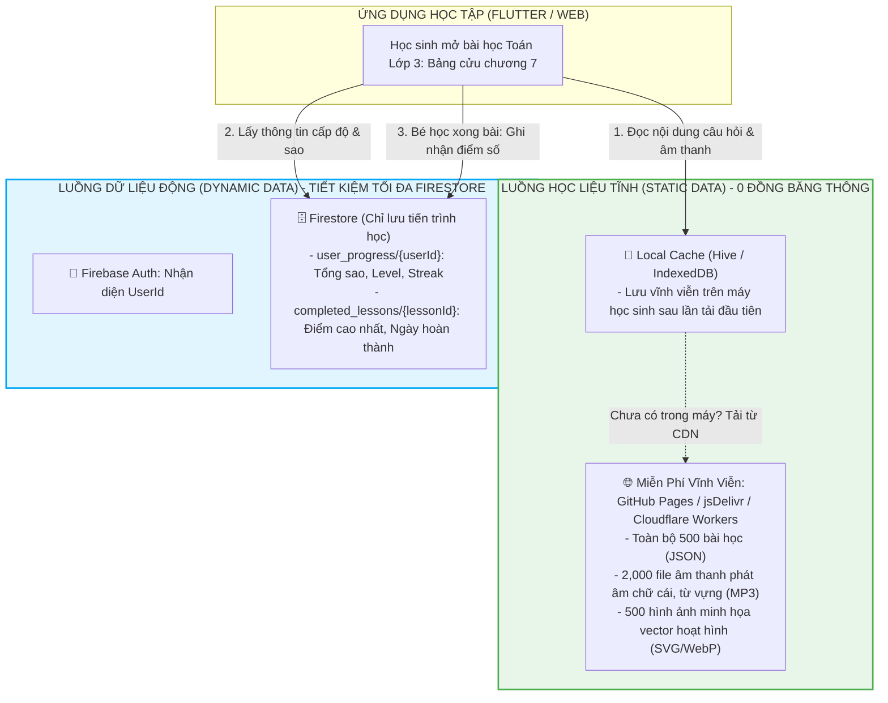

# CHUYÊN ĐỀ 03: CHIẾN LƯỢC TỐI ƯU HÓA TUYỆT ĐỐI GÓI MIỄN PHÍ CỦA FIREBASE (SPARK PLAN)
## Kiến Trúc Vận Hành Bền Vững 0 ĐỒNG Cho Hệ Thống Giáo Dục Hàng Ngàn Học Sinh

---

## 1. Bảng Chi Tiết Hạn Ngạch Gói Firebase Spark (Free Tier Quotas)

Gói **Firebase Spark Plan** là gói dịch vụ hoàn toàn miễn phí của Google dành cho nhà phát triển. Để hệ thống hoạt động ổn định trọn đời mà không bao giờ bị khóa tài khoản hoặc phát sinh hóa đơn ngoài ý muốn, kiến trúc sư phần mềm phải thấu hiểu chính xác từng chỉ số định mức:

| Dịch Vụ Firebase | Định Mức Miễn Phí (Spark Plan) | Nguy Cơ Tiềm Ẩn Nếu Không Tối Ưu | Giải Pháp Kiến Trúc Khắc Phục Tuyệt Đối |
| :--- | :--- | :--- | :--- |
| **Cloud Firestore (Reads)** | **50,000 lượt đọc / ngày** | 1,000 học sinh, mỗi em làm bài tập đọc 50 câu hỏi lẻ tẻ -> **Chạm trần sau 1 giờ sáng**. | **Gom bài học (Bundling)**: Đóng gói toàn bộ câu hỏi của 1 bài vào 1 Document duy nhất + Bật bộ nhớ đệm Offline Cache. |
| **Cloud Firestore (Writes)** | **20,000 lượt ghi / ngày** | Học sinh bấm chọn đáp án mỗi câu ghi 1 lần -> Hết quota ghi rất nhanh. | **Ghi gom (Batch/Buffer Write)**: Chỉ ghi 1 lần duy nhất khi hoàn thành toàn bộ bài học hoặc thoát màn hình. |
| **Cloud Firestore (Storage)** | **1 GB dữ liệu lưu trữ** | Lưu toàn bộ đề bài và dữ liệu lịch sử chi tiết của từng câu hỏi -> Nhanh chóng đầy 1GB. | Chỉ lưu bảng điểm tóm tắt của học sinh. Đề bài và nội dung giáo trình đưa ra ngoài CDN miễn phí. |
| **Cloud Storage (Bandwidth)** | **1 GB tải về / ngày** (Egress) | Trẻ nhỏ nghe tệp âm thanh đánh vần (MP3) và tranh ảnh hoạt hình từ Firebase Storage -> **Vượt ngưỡng sau 100 lượt tải**. | **Tuyệt đối không lưu học liệu tĩnh trên Firebase Storage**. Dùng GitHub CDN / Cloudflare R2 miễn phí 100% băng thông. |
| **Cloud Storage (Storage)** | **5 GB dung lượng** | Đủ dùng nếu chỉ lưu ảnh vẽ / avatar của học sinh. | Nén ảnh kích thước WebP < 50KB trước khi tải lên. |
| **Firebase Hosting** | **10 GB băng thông / tháng**, 10 GB lưu trữ | Tốt cho ứng dụng Web. Nếu vượt 10GB sẽ tạm ngưng. | Nén Gzip/Brotli, sử dụng Service Worker Cache trên trình duyệt. |
| **Firebase Authentication** | **50,000 MAU (Active Users)** / tháng | Dư dả cho các trường tiểu học hoặc cộng đồng học tập vừa và lớn. | Sử dụng **Anonymous Auth** kết hợp liên kết Email phụ huynh khi cần lưu dữ liệu đám mây. |
| **Cloud Messaging (FCM)** | **Không giới hạn (Unlimited)** | Hoàn toàn miễn phí 100%. | Khai thác tối đa để gửi lời khen ngợi và thông báo nhắc học mỗi tối lúc 19:30. |
| **Remote Config** | **Không giới hạn (Unlimited)** | Hoàn toàn miễn phí 100%. | Dùng để đổi chủ đề giao diện mùa lễ hội (Tết, Trung thu) mà không cần cập nhật app. |

---

## 2. Mô Hình "Tách Đôi Dữ Liệu" (Data Segregation Pattern)

Bí quyết quan trọng nhất để ứng dụng chạy với **chi phí 0 đồng** là phân loại rạch ròi 2 luồng dữ liệu:



### Tại sao kiến trúc này tiết kiệm 99% chi phí?
- **Một bài học Toán** gồm 20 câu hỏi có kèm ảnh minh họa và giọng đọc. Nếu lưu trong Firestore + Firebase Storage:
  - 1 học sinh mở bài: Tốn **20 lượt Read Firestore** + **5MB băng thông Storage**.
  - 1,000 học sinh mở bài: Tốn **20,000 Reads** (ngốn 40% quota ngày) + **5GB băng thông** (LẬP TỨC QUÁ TẢI).
- **Với kiến trúc Tách Đôi Dữ Liệu**:
  - Toàn bộ nội dung bài học tải từ CDN miễn phí (băng thông vô hạn).
  - Firestore **TỐN 0 LƯỢT READ** cho nội dung bài học.
  - Khi học xong bài, chỉ ghi **1 lượt Write** lên Firestore để lưu `score: 100, stars: 3`.

---

## 3. Các Kỹ Thuật Tối Ưu Hóa Firestore Cốt Lõi

### 3.1. Kỹ Thuật "Gom Cụm Tiến Trình" (Progress Aggregation Document)
Thay vì tạo ra một Collection `question_history` lưu từng câu hỏi bé làm (gây bùng nổ hàng triệu document), ta gom toàn bộ tiến trình của một môn học vào **1 Document duy nhất**:

```json
// Đường dẫn: /users/{userId}/progress/grade_1_math
{
  "grade": 1,
  "subject": "math",
  "totalStars": 45,
  "completedLessonsCount": 15,
  "lastStudyTimestamp": "2026-09-08T20:30:00Z",
  "lessons": {
    "math_1_01": { "score": 100, "stars": 3, "attempts": 1, "completedAt": "2026-09-01" },
    "math_1_02": { "score": 90, "stars": 2, "attempts": 2, "completedAt": "2026-09-02" },
    "math_1_03": { "score": 100, "stars": 3, "attempts": 1, "completedAt": "2026-09-03" }
  },
  "weakSkills": ["phep_tru_co_nho", "hinh_vuong"]
}
```
- **Lợi ích**: Khi học sinh mở danh sách bài học môn Toán lớp 1, ứng dụng chỉ cần đọc **DUY NHẤT 1 DOCUMENT**. Hệ thống biết ngay bài nào bé đã làm được 3 sao, bài nào chưa làm mà chỉ tốn **1 lượt Read**.

---

### 3.2. Bật Tính Năng Cache Ngoại Tuyến Firestore Tối Đa (Offline Persistence)

Khi cấu hình Firestore SDK trên Client, thiết lập bộ nhớ đệm vĩnh viễn (Unlimited Cache Size):

#### Cấu hình trên Flutter (Mobile & Tablet):
```dart
// main.dart
FirebaseFirestore.instance.settings = const Settings(
  persistenceEnabled: true,
  cacheSizeBytes: Settings.CACHE_SIZE_UNLIMITED, // Không tự động xóa cache gần đây
);
```

#### Cấu hình trên Web (Web Browser):
```javascript
// firebase_config.js
import { initializeFirestore, persistentLocalCache, persistentMultipleTabManager } from "firebase/firestore";

const db = initializeFirestore(app, {
  localCache: persistentLocalCache({
    tabManager: persistentMultipleTabManager() // Đồng bộ cache giữa nhiều tab Chrome/Safari
  })
});
```

- **Cơ chế hoạt động**: Khi học sinh mở lại ứng dụng vào ngày hôm sau, Firestore SDK sẽ tự động kiểm tra bộ nhớ đệm máy trước (Cache First). Nếu dữ liệu hồ sơ chưa thay đổi, **SDK không gửi yêu cầu đọc lên server**, giúp tiết kiệm hoàn toàn lượt Read.

---

### 3.3. Tối Ưu Bảng Xếp Hạng Tuần (Weekly Leaderboard Optimization)
Tính năng bảng xếp hạng là "hung thủ" nguy hiểm nhất làm cạn kiệt Quota Read nếu thiết kế sai (ví dụ: query `collection('users').orderBy('xp', 'desc').limit(100)` mỗi khi có học sinh vào xem).

#### Giải pháp tối ưu: "Bảng Vàng Đóng Băng" (Snapshot Aggregation)
1. Không cho phép client truy vấn trực tiếp toàn bộ collection users.
2. Thiết kế 1 document duy nhất tên là `leaderboards/grade_3_current_week`.
3. Document này chứa mảng danh sách Top 30 bạn điểm cao nhất tuần (chỉ gồm Tên hiển thị, Avatar ID, Điểm XP tuần):
```json
// /leaderboards/grade_3_current_week
{
  "updatedAt": "2026-09-08T00:00:00Z",
  "topUsers": [
    { "rank": 1, "name": "Bé Bống", "avatar": "cat_01", "weeklyXp": 1250 },
    { "rank": 2, "name": "Minh Khang", "avatar": "dragon_02", "weeklyXp": 1180 },
    { "rank": 3, "name": "Gia Huy", "avatar": "owl_01", "weeklyXp": 1050 }
  ]
}
```
- Khi 5,000 học sinh bấm vào tab Bảng Xếp Hạng trong ngày, mỗi em chỉ tốn đúng **1 lượt Read** (thậm chí 0 lượt nếu đã lưu trong local cache của ngày đó).

---

## 4. Tối Ưu Hóa Firebase Authentication (50,000 MAU Miễn Phí)

```mermaid
stateDiagram-v2
    [*] --> GuestUser: Bé mở ứng dụng lần đầu
    GuestUser --> AnonymousAuth: Tự động đăng nhập ẩn danh (Firebase Anonymous Auth)
    Note over AnonymousAuth: Đã có UID riêng biệt, học bình thường, lưu điểm cục bộ
    AnonymousAuth --> ParentalPrompt: Phụ huynh muốn đồng bộ sang máy tính / điện thoại khác
    ParentalPrompt --> LinkEmailAuth: Nhập Email & Mật khẩu phụ huynh (linkWithCredential)
    LinkEmailAuth --> ActiveFamilyAccount: Chuyển đổi an toàn không mất điểm cũ
```

1. **Anonymous Auth (Đăng nhập ẩn danh tức thì)**:
   - Trẻ em lớp 1 không thể tự nhớ mật khẩu phức tạp. Khi mở app, hệ thống tự động sinh tài khoản ẩn danh trong nền. Bé vào chơi và học ngay lập tức.
   - Hoàn toàn nằm trong hạn mức **50,000 người dùng hoạt động hàng tháng (MAU) miễn phí**.
2. **Liên kết tài khoản phụ huynh khi cần (Account Linking)**:
   - Chỉ khi phụ huynh muốn đổi máy hoặc quản lý 2 bé cùng lúc, ứng dụng mới gợi ý nhập Email để liên kết (`linkWithCredential`), không gây cản trở trải nghiệm học tập của trẻ.

---

## 5. Ước Tính Năng Lực Phục Vụ Thực Tế (Capacity Calculation)

Dưới đây là bảng tính toán tải thực tế chứng minh hệ thống hoàn toàn vận hành mượt mà với **10,000 học sinh hoạt động đều đặn mỗi ngày** chỉ với tài khoản Firebase miễn phí:

| Tham Số Tính Toán | Giá Trị Thực Tế | Ghi Chú Tính Toán |
| :--- | :--- | :--- |
| **Số lượng học sinh hoạt động / ngày (DAU)** | **2,500 em** (trên tổng 10,000 học sinh) | Trung bình mỗi ngày có 25% học sinh vào học bài. |
| **Lượt mở bài học trung bình / em** | 3 bài học / ngày | Tổng cộng 7,500 bài học được hoàn thành mỗi ngày. |
| **Lượt Read Firestore tiêu tốn / em** | ~6 Reads / ngày | - 1 Read lấy thông tin User Profile.<br/>- 1 Read lấy tiến trình môn học (Progress doc).<br/>- 1 Read xem Bảng xếp hạng tuần.<br/>- 3 Reads kiểm tra cấu hình. (Nhờ Cache, bài học cũ tốn 0 read). |
| **Tổng lượt Read Firestore toàn hệ thống / ngày** | **15,000 Reads / ngày** | **Chỉ chiếm 30%** định mức 50,000 Reads của Spark Plan. Còn dư 35,000 Reads an toàn! |
| **Lượt Write Firestore tiêu tốn / em** | ~4 Writes / ngày | - 3 Writes cập nhật điểm cho 3 bài học hoàn thành.<br/>- 1 Write cập nhật Streak hàng ngày. |
| **Tổng lượt Write Firestore toàn hệ thống / ngày** | **10,000 Writes / ngày** | **Chỉ chiếm 50%** định mức 20,000 Writes của Spark Plan. Hoàn toàn trong ngưỡng an toàn! |
| **Băng thông Firebase Storage** | **0 MB** | 100% âm thanh và hình ảnh bài học tải từ CDN ngoài. |
| **Băng thông Firebase Hosting** | **~2 GB / tháng** | Web bundle được cache trên trình duyệt người dùng 30 ngày. |
| **TỔNG CHI PHÍ PHÁT SINH** | **0 VNĐ / THÁNG** | **Hệ thống bền vững tài chính 100%.** |
