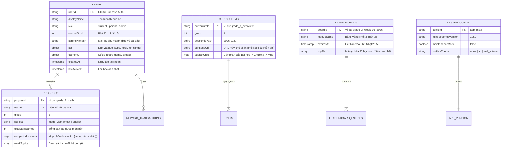
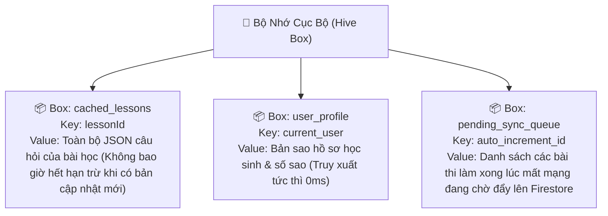

# CHUYÊN ĐỀ 04: THIẾT KẾ CƠ SỞ DỮ LIỆU NOSQL (FIRESTORE) & MÔ HÌNH DỮ LIỆU CỤC BỘ
## Cấu Trúc Schema Tối Ưu Lượt Đọc/Ghi, Chống Phình Dữ Liệu & Hỗ Trợ Đa Nền Tảng

---

## 1. Sơ Đồ Thực Thể Quan Hệ NoSQL (NoSQL Entity Relationship Diagram)

Khác với cơ sở dữ liệu quan hệ (SQL RDBMS) chuẩn hóa bậc 3 (3NF), Cloud Firestore trong ứng dụng này áp dụng triệt để nguyên tắc **Phi chuẩn hóa (Denormalization)** và **Nhúng tài liệu (Document Embedding)** nhằm mục tiêu: *1 Màn Hình = Tối Đa 1 Document Read*.



---

## 2. Đặc Tả Chi Tiết Các Bộ Sưu Tập (Firestore Collections Schema)

### 2.1. Bộ Sưu Tập `users`: Hồ Sơ Học Sinh & Thú Cưng
- **Đường dẫn**: `/users/{userId}`
- **Tần suất truy cập**: Đọc 1 lần khi mở app (được cached trong ngày), Ghi khi thăng cấp hoặc đổi avatar.

```json
{
  "userId": "usr_abc123xyz789",
  "displayName": "Bé Bắp Lém Lỉnh",
  "avatarId": "avatar_super_owl_03",
  "role": "student",
  "currentGrade": 2,
  "parentSettings": {
    "isPinConfigured": true,
    "pinHash": "e3b0c44298fc1c149afbf4c8996fb92427ae41e4649b934ca495991b7852b855",
    "dailyTimeLimitMinutes": 30,
    "bedtimeCurfew": "21:30"
  },
  "mascot": {
    "petId": "mascot_owl",
    "name": "Cú Bibo",
    "level": 4,
    "currentXp": 450,
    "xpToNextLevel": 600,
    "hungerPercent": 85,
    "lastFedAt": "2026-09-08T19:00:00Z",
    "unlockedSkins": ["skin_default", "skin_graduation_cap"]
  },
  "gamification": {
    "stars": 120,
    "gems": 15,
    "currentStreak": 7,
    "maxStreak": 14,
    "lastStreakDate": "2026-09-08",
    "streakFreezeActive": true,
    "unlockedBadges": ["badge_first_100", "badge_math_genius_g1", "badge_streak_7"]
  },
  "createdAt": "2026-08-15T08:00:00Z",
  "updatedAt": "2026-09-08T20:15:00Z"
}
```

---

### 2.2. Bộ Sưu Tập Con `users/{userId}/progress`: Tiến Trình Môn Học
- **Đường dẫn**: `/users/{userId}/progress/{grade_subject}`
- **Ví dụ ID**: `grade_1_math`, `grade_2_vietnamese`, `grade_5_english`.
- **Thiết kế tối ưu**: Thay vì 100 dòng cho 100 bài học, ta dùng Map `completedLessons`. Giúp 1 bài học ghi vào chỉ cập nhật 1 trường (Field Update) bằng cú pháp `completedLessons.lesson_id = { ... }`.

```json
{
  "grade": 1,
  "subject": "math",
  "totalStars": 38,
  "totalCompletedLessons": 14,
  "lastCompletedAt": "2026-09-08T20:10:00Z",
  "completedLessons": {
    "g1_m_u01_l01": {
      "score": 100,
      "stars": 3,
      "timeSpentSeconds": 145,
      "completedAt": "2026-09-05T19:30:00Z"
    },
    "g1_m_u01_l02": {
      "score": 90,
      "stars": 2,
      "timeSpentSeconds": 210,
      "completedAt": "2026-09-06T19:40:00Z"
    },
    "g1_m_u01_l03": {
      "score": 100,
      "stars": 3,
      "timeSpentSeconds": 180,
      "completedAt": "2026-09-08T20:10:00Z"
    }
  },
  "conceptMastery": {
    "dem_so_1_den_10": 1.0,
    "so_sanh_lon_be": 0.85,
    "phep_cong_pham_vi_10": 0.95
  }
}
```

---

### 2.3. Bộ Sưu Tập `curriculums`: Mục Lục Khối Lớp (Metadata Only)
- **Đường dẫn**: `/curriculums/grade_{N}`
- **Mục đích**: Chỉ chứa tiêu đề chương, thứ tự bài học và đường dẫn CDN tệp bài học chi tiết.
- **Dung lượng**: Nhẹ dưới 10KB.

```json
{
  "grade": 1,
  "version": "2026.1",
  "cdnDataUrl": "https://cdn.jsdelivr.net/gh/edu-org/curriculum-data@v1/grade_1/",
  "subjects": {
    "math": {
      "name": "Toán Lớp 1",
      "icon": "icon_math_g1",
      "units": [
        {
          "unitId": "g1_m_u01",
          "title": "Chương 1: Các số từ 0 đến 10",
          "lessons": [
            { "id": "g1_m_u01_l01", "title": "Làm quen với số 1, 2, 3", "contentFile": "g1_m_u01_l01.json" },
            { "id": "g1_m_u01_l02", "title": "Các số 4, 5, 6", "contentFile": "g1_m_u01_l02.json" },
            { "id": "g1_m_u01_l03", "title": "Nhiều hơn - Ít hơn - Bằng nhau", "contentFile": "g1_m_u01_l03.json" }
          ]
        }
      ]
    },
    "vietnamese": {
      "name": "Tiếng Việt Lớp 1",
      "icon": "icon_vietnamese_g1",
      "units": [
        {
          "unitId": "g1_v_u01",
          "title": "Chương 1: Những chữ cái đầu tiên",
          "lessons": [
            { "id": "g1_v_u01_l01", "title": "Làm quen âm A và dấu Huyền (\)", "contentFile": "g1_v_u01_l01.json" },
            { "id": "g1_v_u01_l02", "title": "Làm quen âm B và dấu Sắc (/)", "contentFile": "g1_v_u01_l02.json" }
          ]
        }
      ]
    }
  }
}
```

---

## 3. Cấu Trúc File Bài Học Tĩnh Lưu Trên CDN Miễn Phí (`.json`)

Mỗi bài học (ví dụ: `g1_m_u01_l01.json`) được lưu trữ độc lập trên **GitHub Pages / jsDelivr CDN**, tuyệt đối **không** tốn lượt đọc Firestore:

```json
{
  "lessonId": "g1_m_u01_l01",
  "title": "Làm quen với số 1, 2, 3",
  "grade": 1,
  "subject": "math",
  "passingScore": 80,
  "questions": [
    {
      "questionId": "q01",
      "type": "drag_and_drop",
      "promptText": "Bé hãy kéo 2 quả táo đỏ vào giỏ nhé!",
      "promptAudioUrl": "audio/math_g1_drag_2_apples.mp3",
      "basketCapacity": 2,
      "availableItems": [
        { "id": "apple_1", "image": "images/apple_red.svg" },
        { "id": "apple_2", "image": "images/apple_red.svg" },
        { "id": "apple_3", "image": "images/apple_red.svg" }
      ],
      "correctItemCount": 2,
      "successSound": "audio/sfx_success_cheer.mp3"
    },
    {
      "questionId": "q02",
      "type": "multiple_choice_image",
      "promptText": "Hình nào dưới đây có đúng 3 chú vịt con?",
      "promptAudioUrl": "audio/math_g1_which_has_3_ducks.mp3",
      "options": [
        { "id": "opt_a", "imageUrl": "images/ducks_2.webp", "isCorrect": false },
        { "id": "opt_b", "imageUrl": "images/ducks_3.webp", "isCorrect": true },
        { "id": "opt_c", "imageUrl": "images/ducks_1.webp", "isCorrect": false }
      ]
    }
  ]
}
```

---

## 4. Chiến Lược Đánh Chỉ Mục (Indexing Strategy) Tránh Quá Tải

Trong Cloud Firestore, việc tạo chỉ mục (Index) bừa bãi sẽ làm tăng đáng kể dung lượng lưu trữ (Storage Quota) và làm chậm tốc độ ghi.

### 4.1. Chỉ Mục Tự Động Được Miễn Trừ (Single-Field Index Exemptions)
Đối với các trường chứa Map lớn hoặc Array lớn, ta cấu hình **Miễn trừ chỉ mục (Exemption)** trong `firestore.indexes.json` để không lãng phí tài nguyên:

```json
{
  "indexes": [],
  "fieldOverrides": [
    {
      "collectionGroup": "progress",
      "fieldPath": "completedLessons",
      "indexes": []  // Vô hiệu hóa chỉ mục cho map completedLessons
    },
    {
      "collectionGroup": "users",
      "fieldPath": "gamification.unlockedBadges",
      "indexes": []  // Vô hiệu hóa chỉ mục cho mảng huy hiệu
    }
  ]
}
```

### 4.2. Chỉ Mục Phức Hợp Cần Thiết Duy Nhất (Composite Index)
Chỉ duy nhất một composite index được khuyến nghị nếu cần truy vấn bảng xếp hạng theo cấp độ khối lớp:
- **Collection**: `users`
- **Fields indexed**:
  - `currentGrade`: ASCENDING
  - `gamification.currentStreak`: DESCENDING

---

## 5. Mô Hình Lưu Trữ Ngoại Tuyến Tại Máy Khách (Local Hive / IndexedDB Schema)

Tại Client (Flutter Mobile hoặc Web Browser), chúng ta lưu trữ 3 hộp (Boxes) bằng **Hive / IndexedDB**:



- **Nguyên tắc "Đọc Trước - Hỏi Sau" (Cache First, Network Fallback)**:
  - Khi bé bấm vào một bài học, ứng dụng lập tức kiểm tra `cached_lessons.get(lessonId)`.
  - 95% trường hợp bài học đã có sẵn trong máy -> hiển thị tức thì trong **0.05 giây** mà không tốn bất kỳ một kết nối mạng nào!
