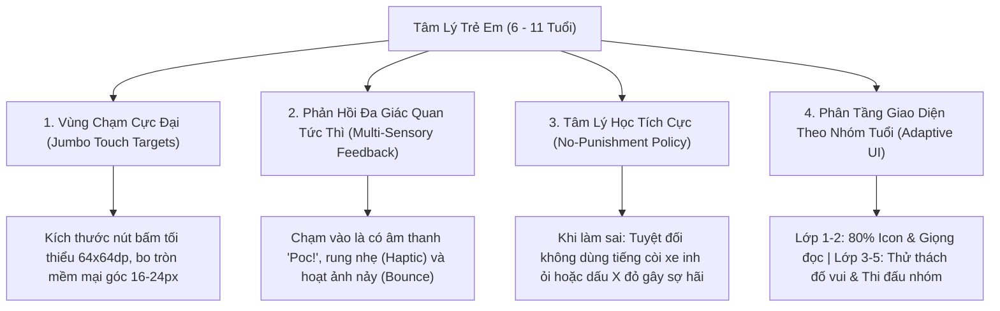
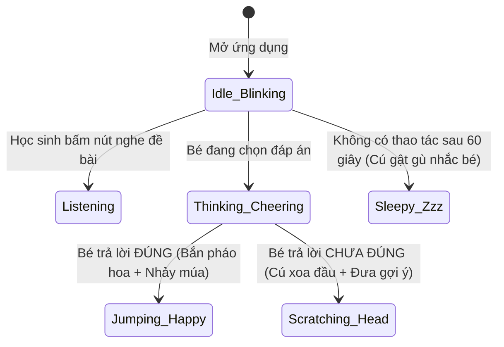
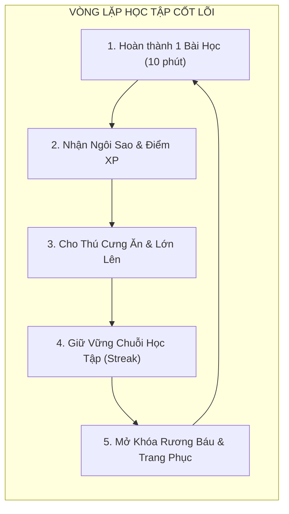

# CHUYÊN ĐỀ 06: THIẾT KẾ TRẢI NGHIỆM NGƯỜI DÙNG (UI/UX) & CƠ CHẾ GAMIFICATION TIỂU HỌC
## Thiết Kế Giao Diện Trực Quan Đa Nền Tảng Cho Trẻ 6 - 11 Tuổi & Vòng Lặp Tâm Lý Động Lực

---

## 1. Tâm Lý Học Trẻ Em & Nguyên Tắc Thiết Kế UI/UX (Child-Centered Design)

Trẻ em tiểu học không phải là "người lớn thu nhỏ"; khả năng phối hợp tay - mắt, nhận thức không gian và khả năng đọc hiểu chữ viết của các em biến đổi rất nhanh qua từng năm tuổi:



---

## 2. Hệ Thống Nhận Diện Thiết Kế (Design System & Typography)

### 2.1. Bộ Font Chữ Chuẩn Giáo Dục Tiểu Học
- **Tiêu đề & Nút bấm**: **`Quicksand`** hoặc **`Comfortaa`** (Google Fonts miễn phí) - Nét chữ tròn trịa, thân thiện, dễ thương, không chân (Sans-Serif) giúp trẻ tiếp thu tự nhiên.
- **Văn bản bài học & Đọc hiểu**: **`Be Vietnam Pro`** - Hiển thị dấu tiếng Việt (Huyền, Sắc, Hỏi, Ngã, Nặng) chuẩn xác tuyệt đối, không bị xô lệch dấu khi phóng to trên máy tính bảng.
- **Mô đun Tập Viết & Nét Chữ Lớp 1**: Sử dụng bộ font ô ly chuẩn tiểu học **`HP001 4 Hàng`** mô phỏng chính xác vở bài tập tập viết của Bộ Giáo dục & Đào tạo.

### 2.2. Bảng Màu Thân Thiện & Bảo Vệ Thị Lực (Child-Safe Color Palette)
Tránh các màu dạ quang (Neon) chói mắt gây mỏi điều tiết mắt của trẻ. Sử dụng bảng màu thiên nhiên, tươi sáng và có độ tương phản đạt chuẩn **WCAG AAA**:

```
[#FF9F43] Vàng Nắng (Chính): Màu của ánh bình minh, tràn đầy năng lượng và niềm vui.
[#10AC84] Xanh Lá Non: Đại diện cho môn Toán & Trạng thái làm bài "Chính xác".
[#54A0FF] Xanh Da Trời: Đại diện cho môn Tiếng Anh & Thế giới khám phá.
[#EE5253] Đỏ San Hô: Nút hành động nổi bật (Play/Tiếp tục), ấm áp, không gây ức chế.
[#F8F9FD] Nền Kem Dịu Mắt: Giảm 60% ánh sáng xanh phát xạ so với nền trắng tinh khiết.
```

---

## 3. Phân Tầng Trải Nghiệm Giao Diện Theo Khối Lớp

### 3.1. Phân Tầng Khối Lớp 1 & Lớp 2: "Thế Giới Cổ Tích Tương Tác" (Storybook Adventure)
- **Tỷ lệ**: 80% Hình ảnh/Âm thanh + 20% Chữ số.
- **Đặc trưng**:
  - Mọi câu hỏi đều có biểu tượng **Chiếc Loa Thông Thái** nhấp nháy phát âm thanh giọng đọc mẫu tự động.
  - Các thao tác hoàn toàn là: Chạm vào bóng bay (Pop), Kéo quả táo vào giỏ (Drag & Drop), Lật thẻ tranh tìm hình giống nhau (Memory Card).
  - Thanh máu / Sinh lực được thay thế bằng **Trái Tim Yêu Thương**. Bé làm sai không bị mất điểm, chỉ cần thử lại với sự gợi ý của linh vật.

### 3.2. Phân Tầng Khối Lớp 3, 4 & Lớp 5: "Học Viện Thám Hiểm Tri Thức" (Academy Quest)
- **Tỷ lệ**: 50% Văn bản logic + 50% Trực quan hóa.
- **Đặc trưng**:
  - Bài tập toán có sơ đồ đoạn thẳng, bảng chia số, kéo thước đo góc hình học.
  - Tích hợp **Bảng Nháp Điện Tử (Magic Scratchpad)**: Bé có thể bấm vào góc màn hình để vẽ nháp tính toán trực tiếp mà không cần tìm giấy bút bên ngoài.
  - Chế độ "Thử thách 60 giây": Rèn luyện phản xạ tính nhẩm bảng cửu chương và ghép từ vựng tiếng Anh.

---

## 4. Động Cơ Hoạt Họa Linh Vật & Âm Thanh (Edutainment Engine)

### 4.1. Hệ Thống Linh Vật Học Tập Tương Tác (Interactive Mascot - Rive State Machine)
Linh vật (Ví dụ: Chú Cú Bibo thông thái) là người bạn đồng hành hiện diện ở góc màn hình:



- **Công nghệ triển khai**: Tệp hoạt ảnh vector **Rive (`.riv`)** dung lượng siêu nhẹ (~30KB), chạy bằng phần cứng GPU mượt mà 60 FPS mà không hề làm nóng máy điện thoại của phụ huynh.

### 4.2. Bảng Âm Thanh Tâm Lý Tích Cực (Positive Sound Effects Matrix)
Mọi âm thanh trong ứng dụng được thiết kế bởi các tần số âm nhạc êm dịu (Pentatonic scale):
- **Âm thanh làm đúng**: Hợp âm Đô - Mi - Sol - Đố (C - E - G - C) kèm tiếng chuông gió trong trẻo + Giọng nói trẻ em "Hoan hô bé!", "Tuyệt vời quá!".
- **Âm thanh làm chưa đúng**: Nốt nhạc trầm nhẹ "Boing~" kèm giọng nói ân cần "Cố lên nào, bé thử lại một lần nữa nhé!". Tuyệt đối không có âm thanh giật mình hay tiếng còi báo động tiêu cực.

---

## 5. Vòng Lặp Động Lực Học Tập & Gamification (Motivation Loop)

Hệ thống ứng dụng mô hình động lực học hành vi **Octalysis Framework** được điều chỉnh riêng cho tâm sinh lý học sinh tiểu học:



### 5.1. Cơ Chế Chuỗi Học Tập Chăm Chỉ (Study Streak with Shield)
- Mỗi ngày bé hoàn thành ít nhất 1 bài học bất kỳ, ngọn lửa Streak sẽ tăng lên (+1 Ngày).
- **Khiên Bảo Vệ Chuỗi (Streak Freeze)**: Phụ huynh hoặc bé có thể dùng 50 Sao để mua 1 chiếc khiên bảo vệ. Nếu cuối tuần bé đi về quê hoặc bị ốm không học được, khiên tự kích hoạt để ngọn lửa chuỗi không bị dập tắt, giữ trọn niềm tự hào của trẻ.

### 5.2. Tủ Kỷ Niệm & Bộ Sưu Tập Huy Hiệu (Virtual Badge Showcase)
Các huy hiệu danh giá được thiết kế như những chiếc huân chương hoạt hình 3D lấp lánh:
- 🏅 **Huy hiệu "Nhà Thám Hiểm Lớp 1"**: Hoàn thành 10 bài học đầu tiên.
- 📐 **Huy hiệu "Bậc Thầy Cửu Chương"**: Đạt điểm tuyệt đối 100/100 tất cả các bài bảng nhân.
- 🦉 **Huy hiệu "Cú Vọ Chăm Chỉ"**: Học liên tục 7 ngày trong tuần.
- 🎨 **Huy hiệu "Họa Sĩ Nhí"**: Hoàn thành bài tập đồ nét chữ cái Tiếng Việt đạt độ chính xác > 90%.

### 5.3. Phòng Nuôi Thú Cưng Ảo (Pet Sanctuary)
- Thú cưng có chỉ số "Năng lượng / Độ no" giảm dần theo thời gian (24 giờ).
- Để thú cưng không bị đói, bé cần học các bài toán và tiếng Việt để kiếm "Táo Vàng" cho thú cưng ăn.
- Khi đạt đủ XP, thú cưng sẽ tiến hóa (Ví dụ: Từ Quả Trứng -> Chú Chim Non -> Cú Thông Thái Đội Mũ Cử Nhân), tạo ra sự gắn kết tình cảm sâu sắc và kích thích tính tự giác học tập mỗi ngày.
