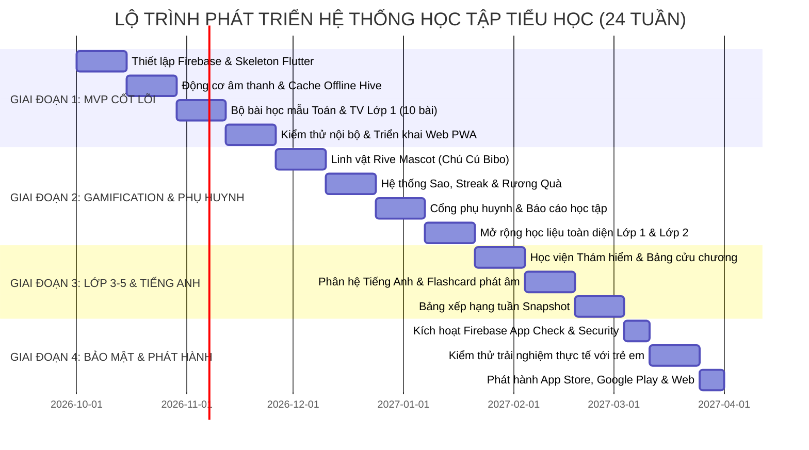
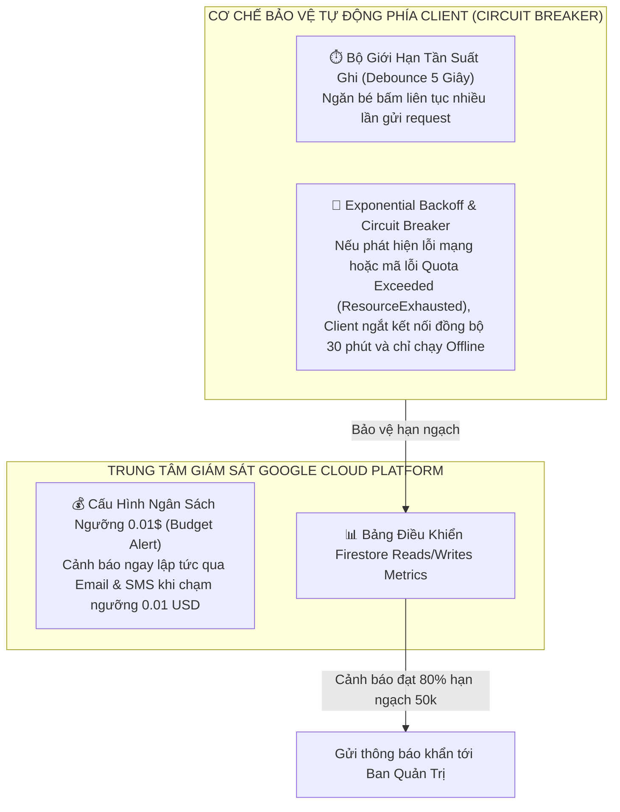

# CHUYÊN ĐỀ 07: LỘ TRÌNH TRIỂN KHAI, KIỂM THỬ VÀ HỆ THỐNG GIÁM SÁT HẠN NGẠCH 0 ĐỒNG
## Kế Hoạch Hiện Thực Hóa Dự Án, Tự Động Hóa CI/CD & Cơ Chế Cảnh Báo An Toàn Chi Phí

---

## 1. Lộ Trình Triển Khai Chi Tiết (Implementation Roadmap)

Dự án được chia làm 4 giai đoạn chiến lược theo chuẩn quy trình phần mềm nhanh nhẹn (Agile/Scrum):



### 1.1. Giai đoạn 1: Xây Dựng Khung Xương Nền Tảng (Tuần 1 - Tuần 8)
- Khởi tạo dự án Flutter đa nền tảng (iOS, Android, Web).
- Cấu hình Firebase Project trên Google Cloud Console (Bật Authentication Anonymous + Firestore Offline Persistence).
- Xây dựng tầng lưu trữ cục bộ **Hive Box** và dịch vụ tải dữ liệu bài học từ CDN tĩnh.
- Triển khai 10 bài học thử nghiệm (5 bài Toán lớp 1 đếm số, 5 bài Tiếng Việt ghép âm A-B-C).
- Xuất bản bản thử nghiệm đầu tiên lên **Firebase Hosting**.

### 1.2. Giai đoạn 2: Trải Nghiệm Edutainment & Giám Sát Phụ Huynh (Tuần 9 - Tuần 16)
- Tích hợp động cơ hoạt họa **Rive Runtime** cho chú Cú thông thái tương tác biểu cảm theo thời gian thực.
- Xây dựng hệ thống kinh tế trong game: Điểm XP, Ngôi sao may mắn, Ngọn lửa Streak và Tủ huy hiệu.
- Phát triển giao diện phụ huynh: Đặt mã PIN bảo vệ, biểu đồ cột thống kê thời lượng học trong tuần.
- Hoàn thiện toàn bộ kho học liệu chương trình Lớp 1 và Lớp 2.

### 1.3. Giai đoạn 3: Mở Rộng Khối Lớp 3, 4, 5 & Tiếng Anh (Tuần 17 - Tuần 22)
- Phát triển các dạng bài tập nâng cao: Bảng cửu chương phản xạ nhanh, phân số hình học trực quan, bài toán đố có lời văn.
- Tích hợp phân hệ Tiếng Anh tiểu học với kho từ vựng và audio giọng đọc chuẩn quốc tế.
- Triển khai cơ chế Bảng vàng tuần (Weekly Leaderboard Snapshot) đảm bảo không tốn quá 1 lượt Read mỗi ngày.

### 1.4. Giai đoạn 4: Gia Cố Bảo Mật, Kiểm Thử & Phát Hành Chính Thức (Tuần 23 - Tuần 24)
- Kích hoạt **Firebase App Check** chặn đứng các truy vấn trái phép từ bên ngoài.
- Rà soát các quy tắc `firestore.rules` và `storage.rules`.
- Tiến hành kiểm thử thực tế với một nhóm 20 học sinh tiểu học (User Acceptance Testing - UAT) để tinh chỉnh độ nhạy nút bấm và âm lượng.
- Đóng gói ứng dụng phát hành lên Google Play Store, Apple App Store và cấu hình tên miền tùy chỉnh cho Web.

---

## 2. Hệ Thống Giám Sát Chi Phí & Cơ Chế Tự Động Ngắt Mạch (Zero-Cost Circuit Breaker)

Để bảo đảm tài khoản **KHÔNG BAO GIỜ** phát sinh dù chỉ 1 đồng tiền phí ngoài ý muốn:



### 2.1. Cài Đặt Cảnh Báo Ngân Sách Google Cloud (Cloud Budget Alert)
1. Đặt ngân sách dự án là **1 USD / tháng**.
2. Thiết lập 3 mốc kích hoạt thông báo cảnh báo qua Email quản trị viên:
   - **50% (0.5 USD)**: Thông báo nhắc nhở kiểm tra nhật ký truy vấn.
   - **90% (0.9 USD)**: Cảnh báo đỏ nguy cơ vượt ngưỡng.
   - **100% (1.0 USD)**: Tự động khóa các quyền ghi của Firestore bằng webhook.

### 2.2. Cơ Chế Tự Ngắt Phía Client (Client Circuit Breaker Pattern)
Trong mã nguồn Flutter, cài đặt bộ đệm đồng bộ thông minh:
```dart
class SafeSyncManager {
  static int _consecutiveErrors = 0;
  static DateTime? _circuitBreakerUntil;

  static Future<void> syncProgressToFirestore(Map<String, dynamic> data) async {
    // 1. Kiểm tra xem cầu dao an toàn có đang ngắt hay không
    if (_circuitBreakerUntil != null && DateTime.now().isBefore(_circuitBreakerUntil!)) {
      print("Circuit breaker active: Dữ liệu được lưu trong máy, tạm hoãn gửi lên Cloud.");
      return;
    }

    try {
      // 2. Thực hiện ghi dữ liệu lên Firestore
      await FirebaseFirestore.instance.collection('progress').doc(data['id']).set(data, SetOptions(merge: true));
      _consecutiveErrors = 0; // Đặt lại số lần lỗi
    } catch (e) {
      _consecutiveErrors++;
      // 3. Nếu xảy ra lỗi liên tiếp quá 3 lần -> Ngắt cầu dao trong 15 phút
      if (_consecutiveErrors >= 3) {
        _circuitBreakerUntil = DateTime.now().add(const Duration(minutes: 15));
        print("Cảnh báo: Ngắt cầu dao đồng bộ 15 phút để bảo vệ quota!");
      }
    }
  }
}
```

---

## 3. Quy Trình Tự Động Hóa Xây Dựng & Triển Khai (CI/CD Pipeline)

Sử dụng **GitHub Actions** (Miễn phí 2,000 phút chạy mỗi tháng cho repository mã nguồn mở hoặc cá nhân) để tự động hóa toàn bộ việc kiểm thử và triển khai:

```yaml
# .github/workflows/deploy_web.yml
name: Tự Động Triển Khai Web App Lên Firebase Hosting

on:
  push:
    branches: [ main ]

jobs:
  build-and-deploy:
    runs-on: ubuntu-latest

    steps:
      - name: 1. Tải mã nguồn (Checkout Code)
        uses: actions/checkout@v4

      - name: 2. Cài đặt môi trường Flutter
        uses: subosito/flutter-action@v2
        with:
          flutter-version: '3.22.x'
          channel: 'stable'
          cache: true

      - name: 3. Cài đặt các gói phụ thuộc
        run: flutter pub get

      - name: 4. Chạy kiểm thử tự động (Unit Tests)
        run: flutter test

      - name: 5. Biên dịch Web Production (HTML/WASM CanvasKit)
        run: flutter build web --release --pwa-strategy=offline-first

      - name: 6. Tự động xuất bản lên Firebase Hosting (0 Đồng)
        uses: FirebaseExtended/action-hosting-deploy@v0
        with:
          repoToken: '${{ secrets.GITHUB_TOKEN }}'
          firebaseServiceAccount: '${{ secrets.FIREBASE_SERVICE_ACCOUNT }}'
          channelId: live
          projectId: your-primary-school-app-id
```

---

## 4. Chiến Lược Kiểm Thử Chuyên Biệt Cho Lứa Tuổi Tiểu Học (Child Usability Testing)

Bên cạnh việc kiểm thử phần mềm truyền thống (Unit Test, Integration Test), ứng dụng cho trẻ em bắt buộc phải trải qua quy trình **Kiểm Thử Trải Nghiệm Lứa Tuổi (Kid Usability Protocol)**:

| Hạng Mục Kiểm Thử | Phương Pháp Thực Hiện | Tiêu Chuẩn Đạt Yêu Cầu (Pass Criteria) |
| :--- | :--- | :--- |
| **Độ nhạy & Vùng chạm nút** | Đưa máy cho 5 em học sinh lớp 1 bấm thử các bài tập chọn đáp án. | Trẻ bấm trúng nút ngay lần đầu tiên đạt tỷ lệ **> 95%**; không bị bấm nhầm sang nút bên cạnh. |
| **Mức độ hiểu đề bài qua âm thanh** | Cho trẻ tự nghe âm thanh hướng dẫn mà không có sự giải thích của người lớn. | **> 90%** các em hiểu được cần phải làm gì (ví dụ: kéo quả táo, gõ chữ cái). |
| **Khả năng chịu đựng thao tác bất thường** | Kiểm thử hành vi trẻ bấm liên tục (Spam Click) 10 lần vào 1 nút hoặc kéo thả lung tung ra ngoài màn hình. | Ứng dụng **không bị văng (Crash)**, âm thanh không bị rè hay lặp tiếng chồng chéo. |
| **Chế độ Ngoại Tuyến (Flight Mode Test)** | Bật chế độ máy bay trên điện thoại rồi mở app làm 3 bài học. | Trẻ vẫn học và hoàn thành bài được bình thường; khi bật lại mạng, điểm số tự động đồng bộ lên mây. |
